#+title: scriba
#+author: Josep Bigorra
#+email: jjbigorra@gmail.com
#+language: en
#+options: toc:nil

[[https://jointhefreeworld.org/ggg/dist/scheme-guile.svg]] [[https://jointhefreeworld.org/ggg/dist/gnu-guix.svg]]
[[https://jointhefreeworld.org/ggg/dist/license-mit.svg]]

*A structured logging framework for GNU Guile Scheme.*

Scriba turns scattered ~display~ calls into real log lines: levelled, taggable,
carrying structured context, and routable to a console, a rotating file, syslog
or JSON — without touching your application code when you move from your laptop
to production.

#+begin_quote
"Scriba is a structured logging library for GNU Guile that prioritizes
flexibility and observability.  It provides modular log routing, formatting,
and filtering, allowing developers to generate human-readable console logs
during development, machine-readable JSON logs for production environments,
and rotating plaintext logs on disk.

Key features include an auto-logger configured via environment variables,
dynamically scoped log contexts using Scheme parameters, ahead-of-time log
level filtering, and minimal runtime overhead achieved through memoization
and compile-time macros."
#+end_quote

*Links:* [[https://codeberg.org/jjba23/scriba][Source & issues]] ·
[[https://jointhefreeworld.org/api-docs/scriba/index.html][API reference]] ·
[[file:CHANGELOG.org][Changelog]] ·
Guix package: ~guile-scriba~

#+attr_html: :width 96 :alt Scriba logo

* At a glance
:PROPERTIES:
:CUSTOM_ID: at-a-glance
:END:

| You want to…                                   | Scriba gives you…                                                          |
|------------------------------------------------+----------------------------------------------------------------------------|
| Understand what your program is doing          | ~log-info~, ~log-warning~, ~log-error~ and friends, with a level hierarchy |
| Correlate lines with a request                 | ~with-log-context~ — dynamically scoped key/value pairs                    |
| Keep a secret out of the log                   | ~default-redacted-keys~ — masks named context values in every backend      |
| Turn categories of logs on and off             | ~with-log-tags~ plus tag filters, with or without levels                   |
| See why something failed, not just that it did | ~with-exception-logging~ — type, message and trace, per backend            |
| Ship structured logs to Loki or Elasticsearch  | A JSON backend that emits one object per line                              |
| Keep logs in a file that does not grow forever | A rotating file backend with size limits and backups                       |
| Change behaviour per environment               | The ~scriba-auto-logger~, configured by ~SCRIBA_*~ variables               |
| Change the level of a running program          | ~(current-logger)~ + ~set-current-logger!~ — a swap a signal handler makes |
| Pay almost nothing for muted log statements    | Ahead-of-time level filtering: a muted call is a no-op                     |

Find the complete technical [[https://jointhefreeworld.org/api-docs/scriba/index.html][API documentation here]].

Available loggers: ~console~, ~color-console~, ~json~, ~syslog~ and ~file~.

#+ATTR_HTML: :width 100% :alt A terminal running Scriba: JSON lines and a console warning
[[https://jointhefreeworld.org/static-assets/scriba/screen-2026-06-02-20-11-36.png]]

* How a log line is made
:PROPERTIES:
:CUSTOM_ID: how-a-log-line-is-made
:END:

A log call is a path, not a print statement. The level filter is decided once,
when the logger is built, so a muted call is bound to a no-op and costs a
function call; what survives it has the context keys you named masked, is
rendered by the logger's layout, and is written to the port the backend was
given. The seam that changes the logger a call site resolves sits outside this
path — see [[file:docs/usage.org::#hot-reconfiguration][Hot Reconfiguration]].

#+attr_html: :width 100% :alt A log call passing the level filter, redaction, the layout and the port

* Features
:PROPERTIES:
:CUSTOM_ID: features
:END:

- *Five backends, one API.* Plain console, colour console, JSON, syslog
  (RFC 5424-shaped) and rotating files. Every backend accepts the same log
  calls, so switching is a configuration decision, not a refactor.
- *Zero-cost muted levels.* Level filtering happens once, at logger
  construction: a level below the threshold is bound to a no-op, skipping
  formatting, flushing and I/O entirely.
- *Environment-driven configuration.* The auto-logger reads ~SCRIBA_*~
  variables, so development and production differ only in their environment.
- *Reconfigure without a restart.* ~(current-logger)~ is read per line and
  ~set-current-logger!~ swaps what it returns, so a ~SIGHUP~ handler can raise
  the level of a running program — in every thread — without threading a new
  logger through every function. Filtering is still ahead of time: a muted
  level is a no-op whichever logger is resolved.
- *Logger memoization.* Asking twice for the same logger configuration returns
  the same instance; creating loggers deep in a call stack is cheap.
- *Structured context, no plumbing.* ~with-log-context~ attaches key/value
  pairs to everything logged inside its body, using Guile's ~parameterize~
  rather than global mutable state or locks.
- *Secrets stay out of the line.* Name the context keys that must never be
  written and ~default-redacted-keys~ masks their values in the engine, before
  any layout renders them — so no template can forget, and a JSON or syslog
  line is masked exactly like a console one.
- *Tags and property-based filtering.* Log with tags instead of levels, or
  alongside levels, and keep only the lines you care about.
- *Exceptions that read like exceptions.* ~with-exception-logging~ logs Guile's
  own rendering of the failure plus the frames that raised it, and each backend
  shows as much as it can carry: indented lines on a terminal, a nested object
  in JSON, one joined line for syslog.
- *Layouts per backend.* Choose which fields are rendered and in which order;
  a mistyped field name is an error, never a silently blank line.
- *Any port is a destination.* ~stdout~, ~stderr~, a file port, a socket port,
  or a string port in your tests — all of Guile's I/O is available.
- *Files that stay manageable.* Size-based rotation with a configurable number
  of backups, UTF-8-correct byte accounting, and an on-demand ~rotate-file!~.
- *Tiny dependency footprint.* Guile itself plus [[https://github.com/aconchillo/guile-json][guile-json]] at runtime. No
  threads, no fibers, no daemons.
- *Hackable by design.* Logger construction is a handful of records, keyword
  arguments and macros — writing your own backend is a page of code
  ([[file:docs/usage.org::#bring-your-own-backend][see the usage guide]]).

* Documentation
:PROPERTIES:
:CUSTOM_ID: documentation
:END:

- [[file:docs/installation.org][Installation]] — ways to install, packages and requirements
- [[file:docs/quick-start.org][Quick Start]] — install, log, run, reconfigure
- [[file:docs/usage.org][Usage]] — loggers, levels, context, redaction, hot reconfiguration, routing and custom backends
- [[file:docs/configuration.org][Configuration]] — environment variables, defaults and parameters
- [[file:docs/why-scriba.org][Why Scriba?]] — motivation, observability and reproducibility
- [[file:docs/comparisons.org][Compared to Other Logging Libraries]] — features, approach and philosophy
  next to Python, Go, Rust, Node, Java and Elixir, with measured throughput
- [[file:docs/performance.org][Performance]] — how muted lines stay cheap, and the benchmarks
- [[file:docs/development.org][Development]] — repository layout, tasks, tests, benchmarks and CI
- [[file:docs/contributing.org][Contributing]] — sending patches, conduct and AI policy
- [[file:CHANGELOG.org][Changelog]] — what each release contains

* Licensing
:PROPERTIES:
:CUSTOM_ID: licensing
:END:

Scriba and all of its source code are free software, licensed under the *MIT License*.  The documentation and
examples provided with Scriba, including this document, are covered by the same
license; see the file LICENSE for the full text.

* Support the project
:PROPERTIES:
:CUSTOM_ID: support-the-project
:END:

If you like my work, please support me by
[[https://bmc.link/jjbigorra][buying me a cup of coffee ☕]] so I can continue with a lot of motivation.

* Credits
:PROPERTIES:
:CUSTOM_ID: credits
:END:

Scriba stands on the shoulders of excellent free software:

- [[https://www.gnu.org/software/guile/][GNU Guile]] — the language and its parameter/port/macro machinery.
- [[https://github.com/aconchillo/guile-json][guile-json]] — JSON serialisation for the JSON backend.
- [[https://codeberg.org/jjba23/veritas][Veritas]] — the test and benchmark runner used by this project.
- [[https://guix.gnu.org/][GNU Guix]] — reproducible development environments and packaging.
